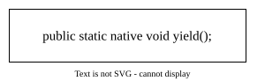
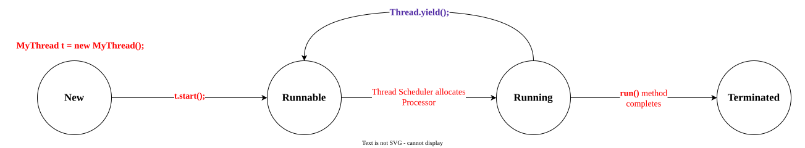
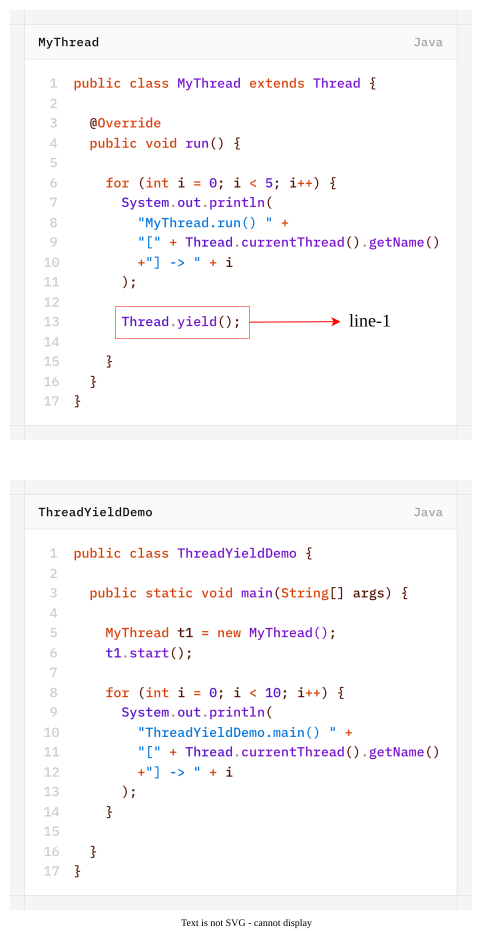

# `yield()`
- `yield()` method causes to pass current executing thread to give the chance for remaining waiting threads of same priority.
- If there is no waiting thread or all waiting threads having low priority then same thread can continue its execution.
- If multiple threads are waiting with the same priority then which waiting thread will get the chance, we can't expect. it depepnds on thread-scheduler.
- The thread which is yielded, when it will get the chance once again, it depends on thread-scheduler and we can't expect exactly.
	

	

In the above program, if we are commenting line-1 then both threads will be executed simultaneously and we can't expect which thread will complete first.

If we are not commenting line-1 then Thread-0 always calls `yield()` and becuase of that `main` thread will get chance more number of times.

Hence, the chance of completing the `main` thread first is high.
>[!NOTE]
>Some platforms (OS) don't provide proper support for `yield()` method.