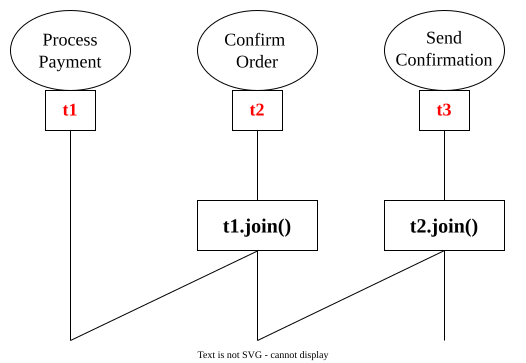
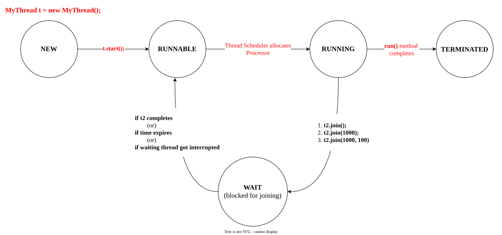
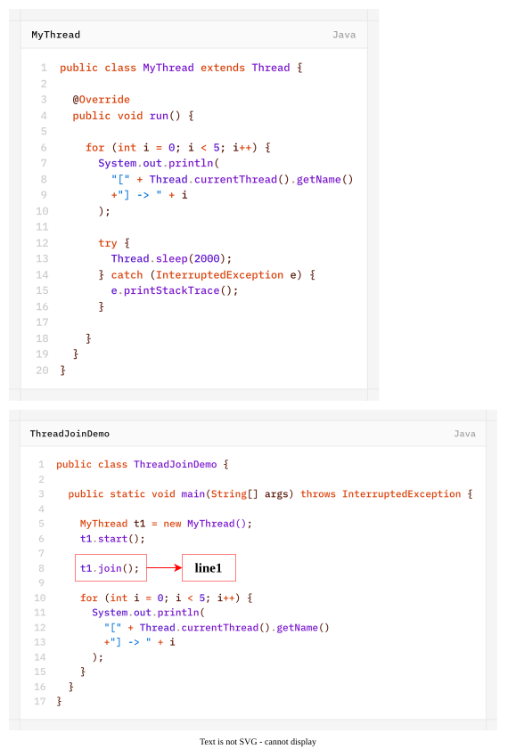
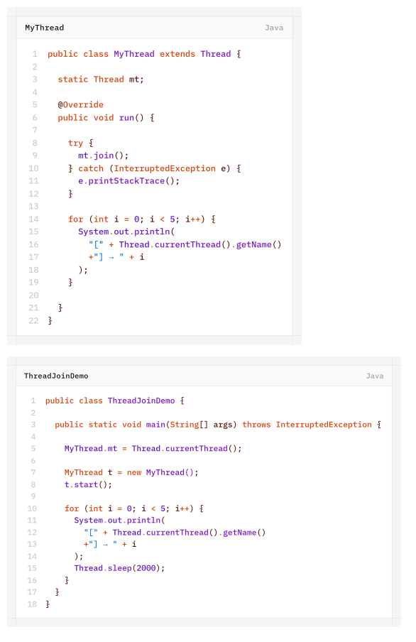
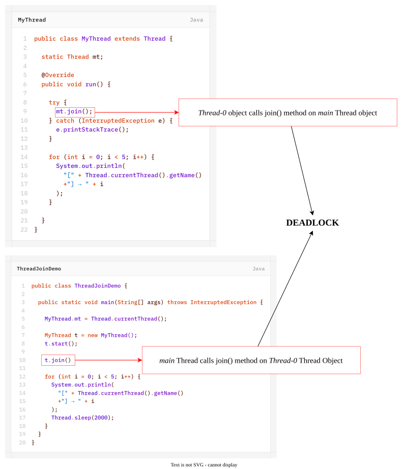

# `join()` method
If a Thread wants to wait until completing some other thread then we should go for `join()` method.

Example:  
- if a Thread t1 wants to wait until completing t2 then t1 has to call `t2.join()`.
- if t1 executes `t2.join()` then immediately t1 will be entered into WAITING state until t2 completes.
- Once t2 completes then t1 can continue its execution.



Confirm Order thread (`t2`) has to wait until Process payment thread (`t1`) completion. hence, `t2` has to call `t1.join()`.

Send Confirmation thread (`t3`) has to wait until Confirm Order thread (`t2`) completion. Hence, `t2` has to call `t3.join()`.

## `join()` Methods
1. `public final void join() throws InterruptedException`
2. `public final void join(long ms) throws InterruptedException`
3. `public final void join(long ms, int ns) throws InterruptedException`
>[!NOTE]
>Every `join()` method throws InterruptedException which is **Checked Exception**. Hence, compulsory we should handle this exception either by using **try-catch** or by **throws** keyword Otherwise, we will get compile-time error.



### Case-1: waiting of `main` thread until completing `Thread-0`


- If we **comment line1** then both `main` and `Thread-0` Threads will be executed simultaneously and we can't except exact execution order.
- If we **do not comment line1** then `main` thread will wait until completing `Thread-0`. and in this case output is :
	```text
	[Thread-0] -> 0
	[Thread-0] -> 1
	[Thread-0] -> 2
	[Thread-0] -> 3
	[Thread-0] -> 4
	[main] -> 0
	[main] -> 1
	[main] -> 2
	[main] -> 3
	[main] -> 4
	```
### Case-2: waiting of `Thread-0` until completing `main` Thread

In the above example `Thread-0` Thread calls `join()` method on `main` Thread object. Hence, `Thread-0` has to wait until completing `main` Thread. In this case output is:
```text
[main] → 0
[main] → 1
[main] → 2
[main] → 3
[main] → 4
[Thread-0] → 0
[Thread-0] → 1
[Thread-0] → 2
[Thread-0] → 3
[Thread-0] → 4
```
### Case-3
If `main` Thread calls `join()` method on `Thread-0` Thread Object and `Thread-0` object calls `join()` method on `main` Thread object then both threads will wait forever and the program will be stucked.

It is something like **"Deadlock"**.

### Case-4
If a Thread calls `join()` method on same Thread itself then the program will be stucked (this is something like **"DEADLOCK"**). in this case Thread has to wait infinite amount of time.

Example:
```java
class Test {
	public static void main(String[] args) throws InterruptedException {
		Thread.currentThread().join();
	}
}
```