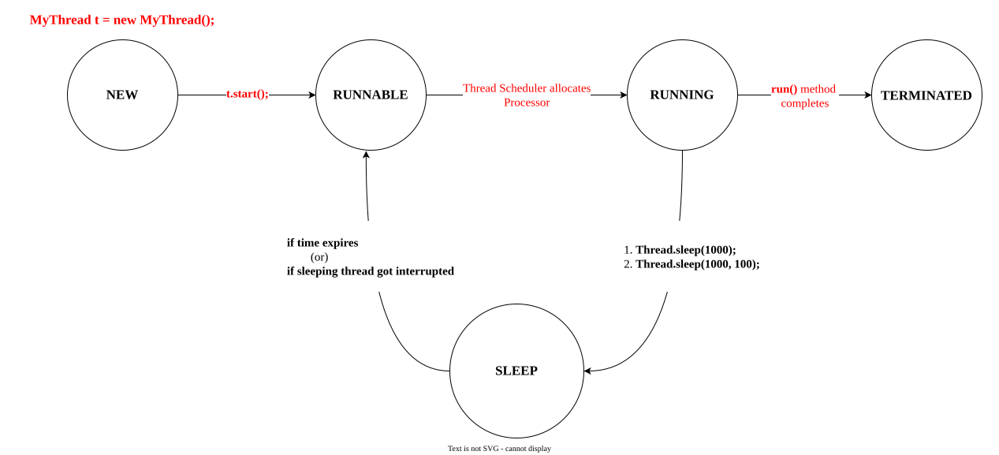
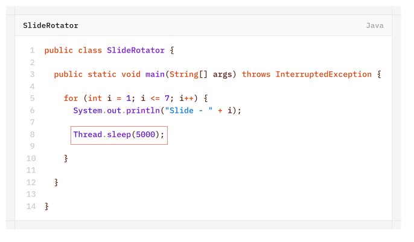

# `sleep()` method
If a Thread don't want to perform any perform any operation for a particular amount of time then we should go for `sleep()` method.
## `sleep()` Methods
1. `public static native void sleep(long ms) throws InterruptedException`
2. `public static void sleep(long ms, int ns) throws InterruptedException`

>[!NOTE]
>Every `sleep()` method throws `InterruptedException`, which is **Checked Exception**. Hence, whenever we are using `sleep()` method compulsory we should **handle** `InterruptedException` either by **try-catch** or by **throws** keyword otherwise we will get compile-time error.

