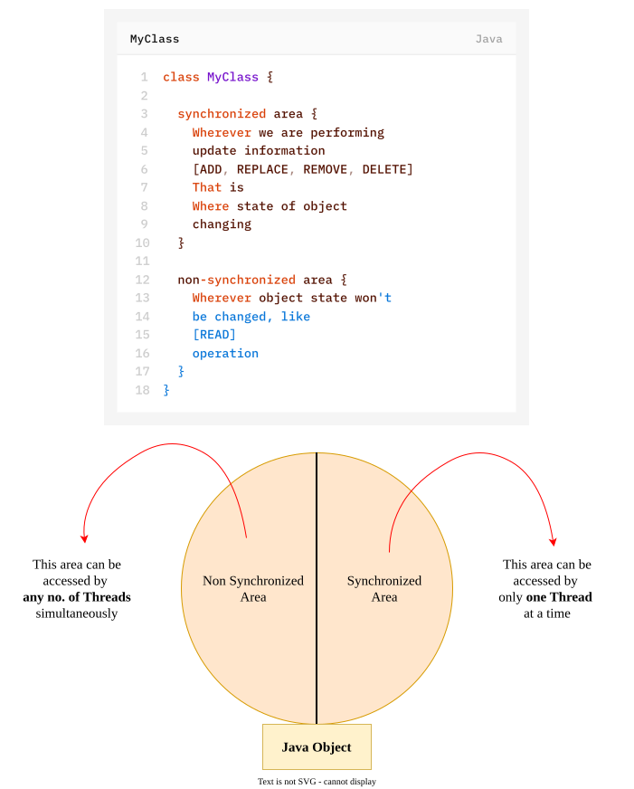

# `synchronized` Method
### Internal mechanism of `synchronized` keyword
(or)
### How does synchronization works in Java Multithreading ?
#### 1. `synchronized` keyword on Instance Method
- `synchronized` keyword on Instance Method works on **Object-Level Lock**.
- In java every object gets exactly one object lock.

If a thread wants to execute a synchronized instance method then…
- it needs to acquire that object lock.
- At the same time, if multiple threads are trying to execute a synchronized instance method on the same object, then the JVM decides which thread is allowed for execution (order not guaranteed).
- Whichever thread is getting scheduled to execute that synchronized method will acquire that Object Lock, while other threads will be in Blocked State.
- Once the thread finishes execution (normally or via exception), it releases the Object Lock.
>[!NOTE]
>When a Thread executes any `synchronized` instance method, other Threads are not allowed to execute any `synchronized` instance method on that **same object** simultaneously.
>
>But at the same time, other Threads are allowed to execute:
>-  non-synchronized instance methods of the same object
>- `synchronized` static methods of that class
>- non-synchronized static method of that class
>[Lock concept is implements based on object but not based on method].
>[Refer this code-1](182-SYNC-VS-NON-SYNC-METHOD-ACCESS-EXAMPLE-1.md)
>[Refer this code-2](184-SYNCHRONIZED-INSTANCE-METHODS-ON-DIFFERENT-OBJECTS.md)
#### 2. `synchronized` keyword on Static Method
- `synchronized` keyword on Static Method works on **Class-Level Lock**.
- In java every class gets **exactly one class lock**.

If a thread wants to execute a synchronized static method then...
- it needs to acquire the class lock — that is, the Object Lock held by the Class object itself (`ClassName.class`), not any instance's lock.
- At the same time if multiple threads are trying to execute a synchronized static method on the same class, then the JVM decides which thread is allowed for execution (order not guaranteed).
- Whichever thread is getting scheduled to execute that synchronized static method, will acquire that Class lock, while other threads will be in Blocked State.
- Once the thread finishes execution (normally or via exception), it releases the Class object's lock.
>[!NOTE]
>Once a Thread acquires **class lock** to execute static synchronized method, then other Threads are not allowed to execute any other `static synchronized` method of that same class simultaneously.
>
>But remaining Threads are allowed to execute:
>- `synchronized` instance method of an object of that class
>- non-synchronized instance methods of an object of that class
>- non-synchronized static methods of that class

