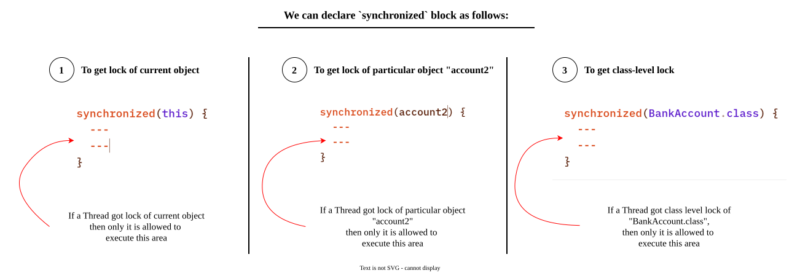

# `synchronized` Block
# Why does `synchronized` block preferred over `synchronized` method ?
**Problem with `synchronized` method**
-  Since whole method is synchronized means both- critical part of the code (which might generate race-condition) and not critical part of the code (which is safer) acquires the lock.
- As a result, other threads that only want to execute non-critical parts of the method are forced to wait unnecessarily.
- it impacts the performance.
---
**Advantage of `synchronized` block over `synchronized` method**
- `synchronized` block is used to `synchronized` only the critical part of the code but not the entire method.
- This means non-critical code runs **without holding any lock** and as a result - other threads aren't blocked from executing that part concurrently.
---

### Example

Performance will be improved and waiting time of threads will be reduce.