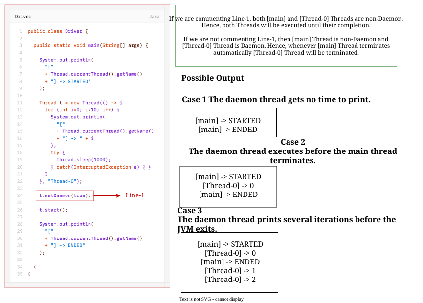

# Daemon Threads
> The Threads which are executing in the background are called **Daemon Threads**.
> **Example:** *Garbage Collector* etc.

The main objective of Daemon Thread is **to provide support for non-Daemon Threads** (main-Thread).
## Example: Garbage Collector
if main-Thread runs with low memory, then JVM runs the Garbage Collector to destroy useless objects, so that the number of bytes of free memory will be improved. 

With this free memory, the main Thread can continue its execution.

Usually Daemon Threads have **low priority** but based on our requirement, a Daemon Thread can run with **high priority** also.

- We can **check** the Daemon nature of a Thread by using `isDaemon()` method of Thread class.
	```java
	public boolean isDaemon()
	```
- We can **change** the Daemon nature of Thread by using `setDaemon()` method.
	```java
	public void setDaemon(boolean b)
	```
	But changing Daemon nature is possible **before starting** of a Thread only.
	
	 After starting a Thread, if we are trying to change Daemon nature, then we will get `RuntimeException : IllegalThreadStateException`.
## Default Nature
By default **main Thread** is always non-Daemon.

and for all remaining Threads, Daemon nature is **inherited from Parent Thread to Child Thread**. 

It means: 
- if a Parent Thread is Daemon, then automatically the Child Thread is also Daemon.
- If a Parent Thread is not Daemon, then automatically Child Thread is also not Daemon.

>[!NOTE]
>It is **impossible** to change Daemon nature of the main Thread, because the main Thread is started by JVM at the beginning.

```java
package daemonThread;

public class Driver {

	public static void main(String[] args) {
		
		System.out.println(
			Thread.currentThread().isDaemon()
		); // false
		
		// Thread.currentThread().setDaemon(true); // -> IllegalThreadStateException
		
		Thread t = new Thread("Thread-0");
		
		System.out.println(t.isDaemon()); // false
		
		t.setDaemon(true);
		
		System.out.println(t.isDaemon()); // true
	}
}
```
Whenever last non-Daemon Thread terminates automatically all Daemon Threads will be terminated irrespective of their position.

> [!NOTE]
> When all non-daemon threads have terminated, the JVM can begin its shutdown process. Daemon threads do not prevent this shutdown and may be terminated before completing their tasks
