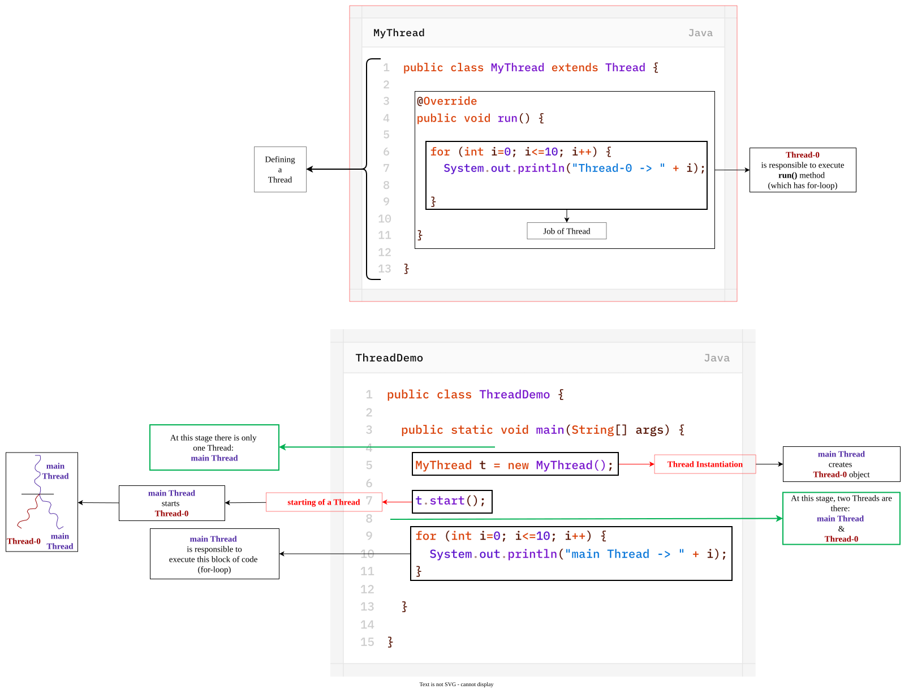
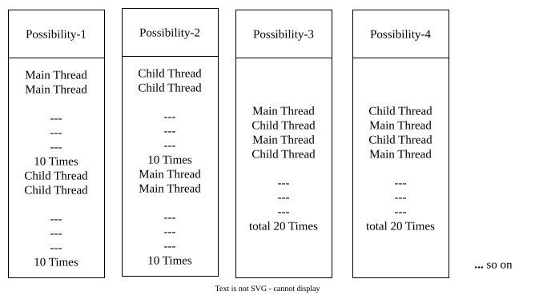
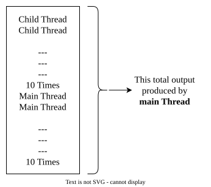
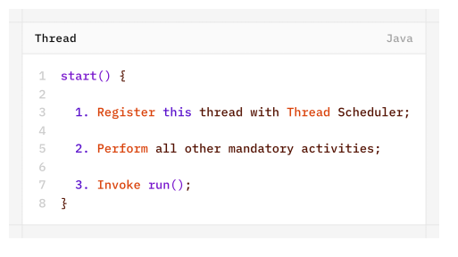
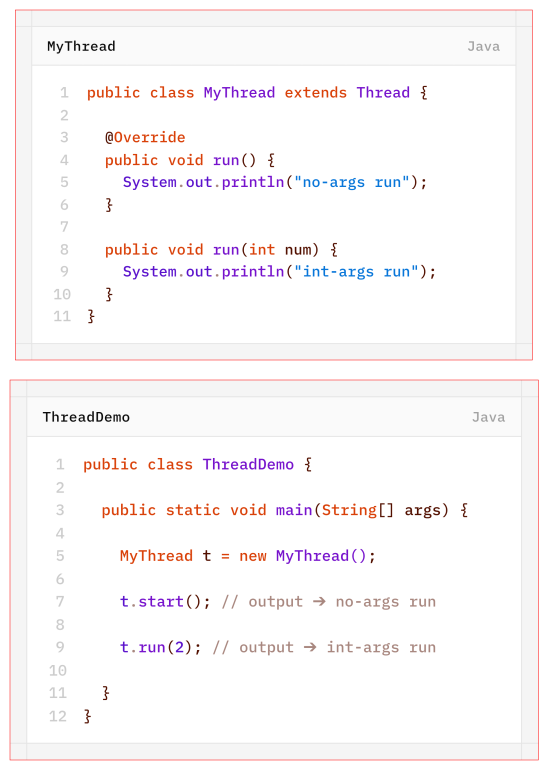
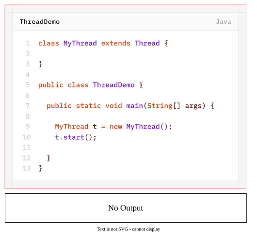
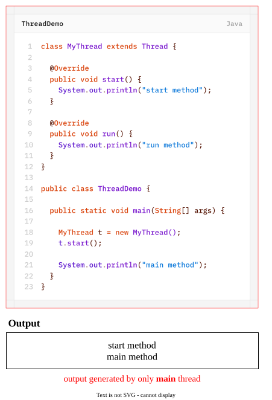
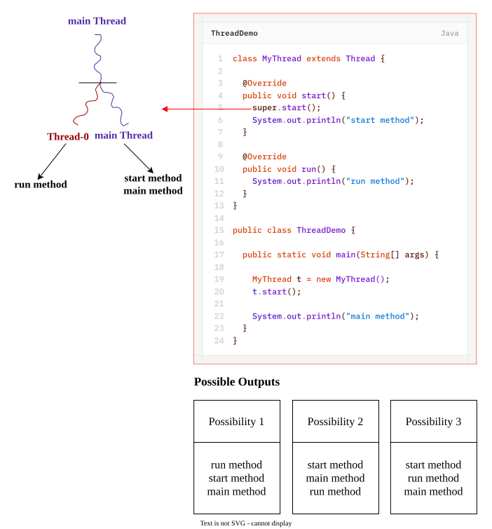
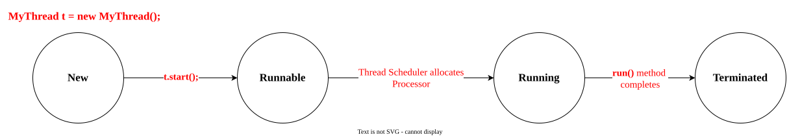
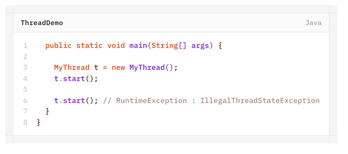

# Define a Thread By extending `Thread` class
Creating our own Thread by extending **`Thread`** class:
1. **Create a class that extends the `Thread` class.**
2. **Override the `run()` method.**
3. **Write the task/code that the thread should execute inside the `run()` method.**
4. **Create an object of the custom thread class inside the `main()` method.**
5. **Call `start()` on the thread object to start the thread.**

Example-1:
```java
class MyThread extends Thread {
	
	@Override
	public void run() {
		for (int i=0; i<=10; i++) {
			System.out.println("Thread-0 -> " + i);
		}
	}
}

public class ThreadDemo {

	public static void main(String[] args) {
		
		MyThread t = new MyThread();
		t.start();
		
		for (int i=0; i<=10; i++) {
			System.out.println("main Thread -> " + i);
		}
	}
}
```


Example-2:
```java
class MyThread extends Thread {

	@Override
	public void run() {
		System.out.println("Executing run()...");
		System.out.println(
			"MyThread : This code is executed by [" +
			Thread.currentThread().getName() + "] thread"
		);
	}
}

class Driver {

	public static void main(String[] args) {
		
		System.out.println("START main()");
		
		System.out.println(
			"Driver : This code is executed by [" +
			Thread.currentThread().getName() + "] thread"
		);
		
		MyThread t1 = new MyThread(); // Thread Instantiation
		System.out.println("Thread-0: " + t1.getName());
		t1.start();
		
		MyThread t2 = new MyThread(); // Thread Instantiation
		System.out.println("Thread-1: " + t2.getName());
		t2.start();
		
		MyThread t3 = new MyThread(); // Thread Instantiation
		System.out.println("Thread-2: " + t3.getName());
		t3.start();

		System.out.println("END main()");
	}

}
```
## Case 1: Thread Scheduler
- It is the part of JVM.
- It is responsible to schedule threads i.e, if multiple threads are waiting to get a chance of execution then in which order threads will be executed is decided by **Thread Scheduler**.
- We can't expect exact algorithm followed by thread scheduler. it is varied from JVM-to-JVM, hence we can't expect thread execution order and exact output.
- Hence whenever situation comes to multithreading, there is no guarantee for exact output but we can provide several possible outputs.
- The following are various possible outputs for the above program (Example-2):
	
## Case 2: Difference between `t.start()` & `t.run()`
- In the case of `t.start()`, a new thread will be created which is responsible for the execution of `run()` method.
- In the case of `t.run()`, a new thread won't be created and `run()` method will be executed just like a **normal method called by main thread**.
  Hence in the above program, if we replace `t.start()` with `t.run()` then the output is-

	
## Case 3: Importance of Thread class `start()` Method
Thread class start() method is responsible to register the thread with thread scheduler and all other mandatory activites.
Hence, without executing Thread class `start()` method, there is no chance of starting a new thread in Java, due to this Thread class `start()` method is consider as **Heart of Multithreading**.

## Case 4: Overloading of `run()` method
Overloading of `run()` method is always possible but Thread class `start()` method can invoke no-args `run()` method.
The other overloaded `run()` method with some args, we have to call explicitly like a normal method call.

## Case 5: Overriding run() method
If we are not overriding `run()` method then **Thread class run() method will be executed** which has empty implementation hence we won't get any output.

>[!NOTE]
>It is highly recommended to override `run()` method otherwise don't go for multithreading concept.

## Case 6: Overriding `start()` method
If we override start() method, out start() method will be executed just like a normal method call and new thread won't be created.


>[!WARNING]
>It is not recommended to override `start()` method otherwise don't go for multithreading concept.
  
## Case 7

## Case 8: Thread Lifecycle

## Case 9
After starting a thread if we are trying to restart the same thread then we will get RuntimeException : IllegalThreadStateException.

