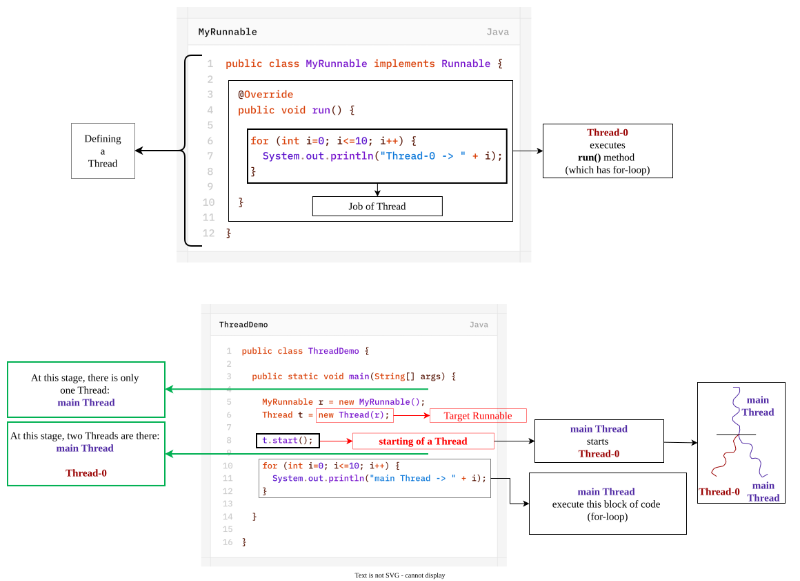
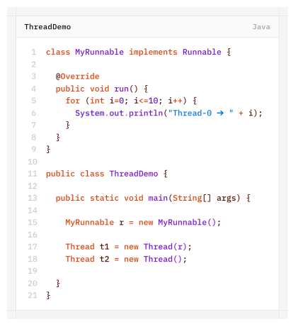

# Define a Thread by implementing `Runnable` Interface
We can define a thread by implementing `Runnable` (I).
- **`Runnable` (I)** presents in **`java.lang`** package and it contain only one method- **run()** method.
	`public abstract void run();`

We will get mixed output and we can't tell exact output.
## Case Studies

### Case 1
```java
t1.start();
```
A new thread will be created, which is responsible for execution of `Thread` class `run()` method, which has empty implementation.
### Case 2
```java
t1.run();
```
No new thread will be created and `Thread` class `run()` method will be executed just like a normal method call.
### Case 3
```java
t2.start();
```
A new thread will be created which is responsible for the execution of `MyRunnable` class `run()` method.
### Case 4
```java
t2.run();
```
A new thread won't be created and `MyRunnable` class `run()` method will be executed just like a normal method call.
### Case 5
```java
r.start();
```
We will get a **Compile Time Error** - MyRunnable class doesn't have start capability
`Compiletime-Error: The method start() is undefined for the type MyRunnable : class MyRunnable`
### Case 6
```java
r.run();
```
No new thread will be created and `MyRunnable` class run() method will be executed just like a normal method call.