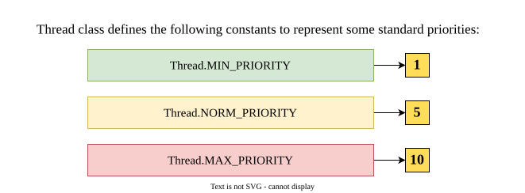
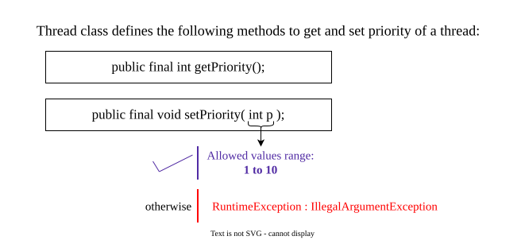
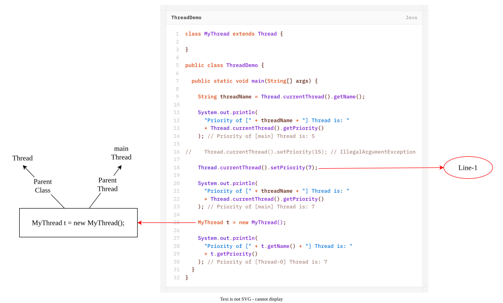
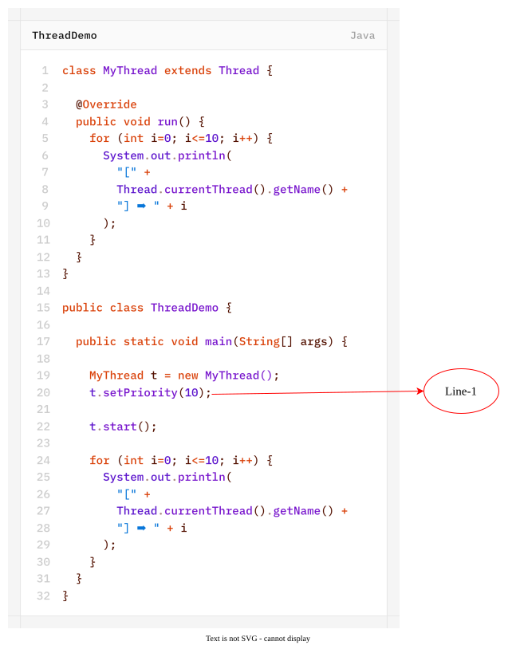

Every thread in Java has some priority, it may be default priority generated by JVM (or) customized priority provided by programmer.

The valid range of thread-priority is **1-10**, where 1 is **Min Priority** and 10 is **Max Priority**.


Which is valid and which is invalid

|  #  |        Priority        | Valid / Invalid |
| :-: | :--------------------: | :-------------: |
|  1  | `Thread.LOW_PRIORITY`  |        ✕        |
|  2  | `Thread.HIGH_PRIORITY` |        ✕        |
|  3  | `Thread.MIN_PRIORITY`  |        ✓        |
|  4  | `Thread.NORM_PRIORITY` |        ✓        |
- Thread scheduler uses these priorities while allocating processor.
- The thread which is having highest priority will get the chance first.
- If two threads having same priority then we can't expect the exact execution order. it depends on Thread-Scheduler.



Example:
1. `t.setPriority(7);` ➞ **✓**
2. `t.setPriority(17);` ➞ **`IllegalArgumentException`**

## Default Priority
The default priority only for the **main** thread is 5. but for all remaining threads, the default priority will be inheriting from parent to child. That is whatever the priority parent thread has, by default the same priority will be there for the child thread also.


If we comment Line-1 then Thread-0 priority will become 5.

If we are **commenting Line-1** then both Thread-0 and main Thread have the same priority 5 and hence we can't expect the execution order and exact output.

If we are **not commenting Line-1** then main Thread has the priority 5 and Thread-0 has the priority 10. Hence, Thread-0 will get the chance first followed by main Thread.
In this case output is:
```text
[Thread-0] ➡ 0
[Thread-0] ➡ 1
[Thread-0] ➡ 2
[Thread-0] ➡ 3
[Thread-0] ➡ 4
[Thread-0] ➡ 5
[Thread-0] ➡ 6
[Thread-0] ➡ 7
[Thread-0] ➡ 8
[Thread-0] ➡ 9
[Thread-0] ➡ 10
[main] ➡ 0
[main] ➡ 1
[main] ➡ 2
[main] ➡ 3
[main] ➡ 4
[main] ➡ 5
[main] ➡ 6
[main] ➡ 7
[main] ➡ 8
[main] ➡ 9
[main] ➡ 10
```
>[!NOTE]
>Thread priority is a scheduling hint. A higher-priority thread may receive CPU time before a lower-priority thread, but Java does **not guarantee execution order** based on thread priority. The actual scheduling behavior depends on the JVM and underlying operating system. Therefore, the above output may occur, but it is not guaranteed.