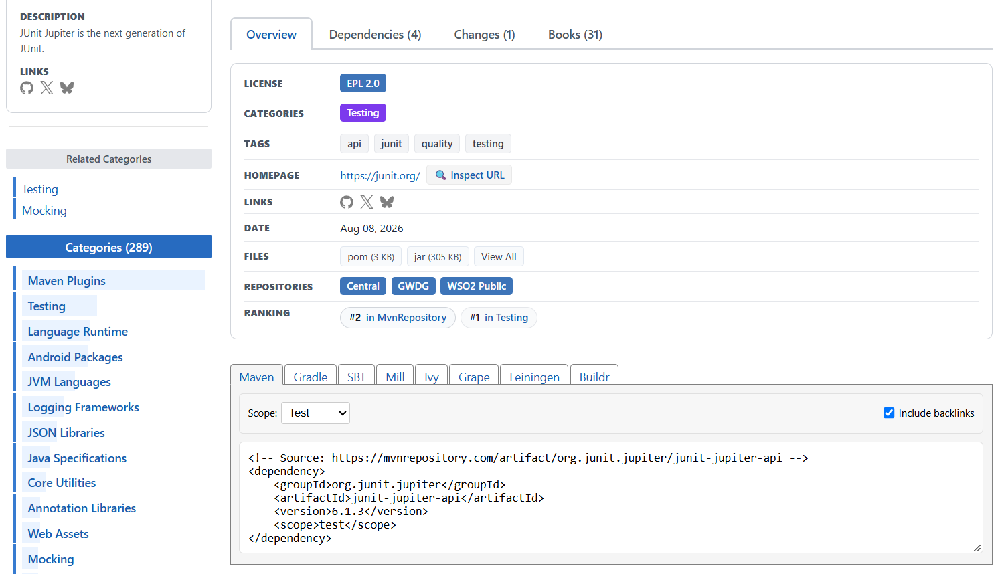

# Introduction to `POM.xml`
> `pom.xml` (Project Object Model) is an XML configuration file which is used by Maven to manage a Java project's dependencies, build configuration, project information, and other build-related settings.

It is generally located in the root directory of a Maven project.

Example of a `pom.xml`
```xml
<project>
    <modelVersion>4.0.0</modelVersion>

    <groupId>com.zepto</groupId>
    <artifactId>product-management</artifactId>
    <version>0.0.1</version>

    <dependencies>
        <dependency>
            <groupId>org.junit.jupiter</groupId>
            <artifactId>junit-jupiter</artifactId>
            <version>5.11.4</version>
            <scope>test</scope>
        </dependency>
    </dependencies>

</project>
```
## How to Add a Dependency to `pom.xml`?
Follow these steps:
 1. Open [Maven Central Repo](https://mvnrepository.com/) .
 2. Search for the required dependency. For example, `JUnit Jupiter API`.
 3. Click on the dependency.
4. Select the required version.
5. Select **Maven** and copy the dependency code.

Example
```xml
<!-- Source: https://mvnrepository.com/artifact/org.junit.jupiter/junit-jupiter-api -->
<dependency>
    <groupId>org.junit.jupiter</groupId>
    <artifactId>junit-jupiter-api</artifactId>
    <version>6.1.3</version>
    <scope>test</scope>
</dependency>
```


6. Paste this code inside the `<dependencies></dependencies>` section of your `pom.xml`.
7. Save the file. In Eclipse, right-click the project and select **Maven → Update Project**, or press `Alt + F5`. This allows Maven to resolve the dependency.
## Where Does Maven Download the JAR File?
When we add a dependency to `pom.xml`, Maven checks whether the required artifact is already available in the local repository.

If it is not available, Maven downloads it from a configured remote repository, such as Maven Central, and stores it in the local repository.

On Windows, the default location is:
```text
C:\Users\myUser\.m2\repository\
```
For example, the JUnit Jupiter API JAR will be stored under a directory structure based on its `groupId`, `artifactId`, and `version`.
```text
.m2
└── repository
    └── org
        └── junit
            └── jupiter
                └── junit-jupiter-api
                    └── 6.1.3
                        └── junit-jupiter-api-6.1.3.jar
```
## Can Multiple Projects Use the Same JAR?

Yes.

Suppose Project A needs JUnit Jupiter API version `6.1.3`.

When we add this dependency inside `pom.xml`, Maven downloads the required JAR and saves it inside the local repository:

`C:\Users\myUser\.m2\repository\`

Now, suppose Project B also needs the same JAR of version `6.1.3`.

Maven will use the JAR which is already present inside the local repository. It does not need to download it again.

>[!NOTE]
>- All Maven projects on the same system can use the same local repository by default.
>- If another project needs a different version of the JAR, Maven will download that version separately if it is not already available.
>- We must add the dependency inside each project's `pom.xml`. Just having the JAR inside the local repository is not enough.

## How Do Companies Manage Dependencies Securely?
In a company, developers usually do not download dependencies directly from  [Maven Central Repo](https://mvnrepository.com/) . Instead, the company may use an **internal Maven repository** to manage dependencies.
### Why is this needed?
Suppose a developer needs a JAR file for a project.

That JAR might contain vulnerable code or malicious code that can harm the company's systems.

To reduce this risk, companies follow a process like this:
1. The developer requests the required dependency.
2. The company's InfoSec team or security tools download and check the dependency for known vulnerabilities and other security risks.
3. If the dependency passes the company's checks, it can be made available through the company's internal Maven repository.
4. If the dependency has a serious security issue, the company may block it until the issue is resolved.
5. Developers download approved dependencies through the company's internal repository.
### How does a Maven Project know which repository ( [Maven Central Repo](https://mvnrepository.com/) (or) company's internal Maven repository) to use?
Developers configure Maven's `settings.xml` file to use the company's internal Maven repository.

The default location on Windows is:
```text
C:\Users\myUser\.m2\settings.xml
```
Example of **`settings.xml`**:
```xml
<?xml version="1.0" encoding="UTF-8"?>

<settings xmlns="http://maven.apache.org/SETTINGS/1.2.0"
          xmlns:xsi="http://www.w3.org/2001/XMLSchema-instance"
          xsi:schemaLocation="http://maven.apache.org/SETTINGS/1.2.0
                              https://maven.apache.org/xsd/settings-1.2.0.xsd">

    <!-- 1. Local Repository
         Default location: C:\Users\Mraj\.m2\repository\
         Maven stores downloaded dependencies here.
         Uncomment the line below only if you want to
         change the default location.
    -->
    <!-- <localRepository>${user.home}/.m2/repository</localRepository> -->


    <!-- 2. Interactive Mode
         Controls whether Maven asks for user input
         when needed. The default is true.
    -->
    <interactiveMode>true</interactiveMode>


    <!-- 3. Offline Mode
         Set to true to prevent Maven from accessing
         remote repositories. The default is false.
    -->
    <offline>false</offline>


    <!-- 4. Plugin Groups
         Additional group IDs Maven searches when
         resolving plugin prefixes. No extra groups
         are required for this example.
    -->
    <pluginGroups>
    </pluginGroups>


    <!-- 5. Proxies
         Configure a network proxy here if your company
         requires one to access remote repositories.
    -->
    <proxies>
    </proxies>


    <!-- 6. Servers
         Store authentication configuration for
         repositories that require credentials.
         The server ID must match the repository or
         mirror ID that requires authentication.
    -->
    <servers>
    </servers>


    <!-- 7. Mirrors
         Redirect repository requests to the company's
         internal Maven repository.
         Replace the example URL with the actual URL
         provided by your company.
         mirrorOf = * applies this mirror to all
         repository requests covered by the setting.
    -->
    <mirrors>
        <mirror>
            <id>company-repository</id>
            <mirrorOf>*</mirrorOf>
            <url>https://your-company-repository-url</url>
        </mirror>
    </mirrors>


    <!-- 8. Profiles
         Define additional settings, such as repository
         definitions and properties, when required.
    -->
    <profiles>
    </profiles>


    <!-- 9. Active Profiles
         Activate profiles defined above when required.
         No profiles are activated in this example.
    -->
    <activeProfiles>
    </activeProfiles>

</settings>
```
### What happens when a developer adds a dependency?
1. The developer adds the dependency inside `pom.xml`.
2. Maven checks the local repository on the developer's computer.
3. If the required dependency is not available locally, Maven requests it from the company's internal repository.
4. If the dependency is available and permitted, Maven downloads it and stores it in the local repository.